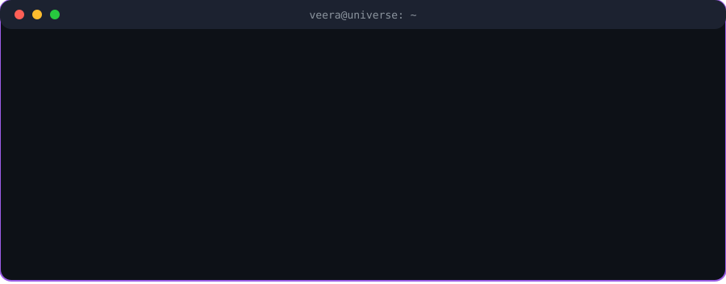

<div align="center">
  
</div>

<br clear="both">

<div align="center">
  
</div>

###

<h1 align="left">Heyy👋🏼, I'm Veera😎</h1>

###

<h1 align="left">About me</h1>



<br clear="both">


###

<p align="left">✨ CSE student &amp; developer<br>💻 Interests: Full-stack development, Flutter, backend APIs<br>🤖 Exploring: AI applications<br>📚 Currently learning: System design, scalable architectures<br>🎯 Goals: Build impactful products and grow as a software engineer<br>🎲 Fun fact: Code works… until I deploy it 😄</p>

<br clear="both">

<h2 align="left">🪐 My Tech Universe</h2>

My skills, orbiting around me. Just watch them drift.



<h2 align="left">💻 Tech Stack</h2>

<div align="center">
  
  
  
  
  
  
  
  
  
  
  
  
  
  
  
  
  
  
  
  
  
  
  
  
  
  
  
  
  
  
  
  
  
  
  
  
  
  
  
  
  
  
  
  
  
  
  
  
  
  
  
  
  
  
  
  
  
  
  
</div>

###

<h2 align="left">🎒 Skill Inventory</h2>

| Slot | Item | Power |
|:--|:--|:--|
| 🗡️ Main weapon | Flutter &amp; Dart | `█████████░` 90% |
| 🛡️ Shield | Python · Django · FastAPI | `████████░░` 80% |
| 🧪 Potion | React · Next.js · TypeScript | `███████░░░` 75% |
| 🔮 Spellbook | System design (learning!) | `█████░░░░░` 50% |
| 🤖 Familiar | AI &amp; OpenCV experiments | `█████░░░░░` 50% |

<h2 align="left">🎯 Level-Up Roadmap</h2>

```text
[✔] Learn full-stack fundamentals
[✔] Ship Flutter apps + backend APIs
[▶] Master system design & scalable architectures   <-- you are here
[ ] Build AI-powered products
[ ] Ship something that impacts real people
[ ] Become a great software engineer 🚀
```

<details>
<summary><b>🎮 Mini game: Deploy to production (click me!)</b></summary>
<br/>

You push your code. Tests pass. Confidence: 100%. What now?

<details>
<summary>🚀 Deploy on Friday evening</summary>

💥 `500 Internal Server Error`... but it worked on my machine. **GAME OVER** 💀
</details>

<details>
<summary>🧪 Write one more test first</summary>

✅ You found 3 bugs. Production stays calm. **YOU WIN** 🏆
</details>

<details>
<summary>☕ Grab coffee and think</summary>

🧠 You realise you forgot the `.env` file. Crisis avoided. **GOOD ENDING** 🎉
</details>

</details>

<h2 align="left">Get in Touch👇🏼</h2>

<div align="left">
  <a href="mailto:veerabathirannatrajan@gmail.com" target="_blank"></a>
  <a href="https://www.linkedin.com/in/veera-bathiran/" target="_blank"></a>
  <a href="https://www.instagram.com/_veera.exe/" target="_blank"></a>
  <a href="https://gitlab.com/veerabathirannatrajan" target="_blank"></a>
</div>

###


###

<div align="center">
  
</div>

###

<h2 align="left">📈 MY STATS</h2>

<div align="center">
  
  
</div>

<br/>

<div align="center">
  
</div>


<div align="center"><sub>Made with 💜 by Veera · thanks for stopping by!</sub></div>
